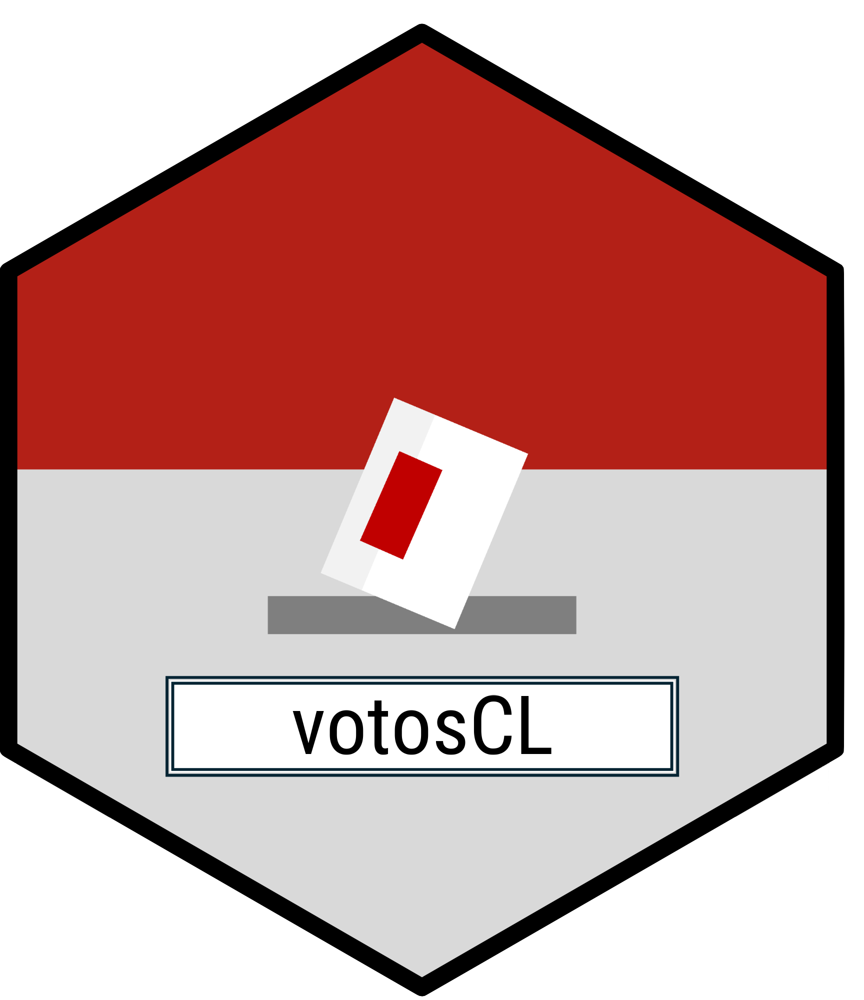

<!-- README.md is generated from README.Rmd. Please edit that file -->

# votosCL 

<!-- badges: start -->

<!-- badges: end -->

Trabajar con las bases de datos

¿Qué es lo nuevo?

- Sexo en las últimas elecciones.
- Estandarización de los nombres.
- Recopilación de todas la información desde las elecciones en 1989.

## Instalación

El paquete votosCL puedes instalarlo a través de GitHub:

``` r
# install.packages("pak")
pak::pak("snaraya/votosCL")
```

## Datos

El paquete se compone de múltiples bases de datos que contienen los
resultados electorales del Servicio Electoral de Chile (SERVEL).

### Base de datos histórico por tipo de elección

Puedes encontrar las bases de datos de acuerdo al proceso electoral de
tu interés:

<table>
<colgroup>
<col style="width: 25%" />
<col style="width: 74%" />
</colgroup>
<thead>
<tr>
<th>Base de datos</th>
<th>Descripción</th>
</tr>
</thead>
<tbody>
<tr>
<td>elecciones_alcalde</td>
<td>Elecciones desde el 2004 en adelante.</td>
</tr>
<tr>
<td>elecciones_presidente</td>
<td><p>Elecciones desde 1989 en adelante.</p>
<p>Puedes filtrar la información utilizando el tipo de proceso
(primaria, primera y segunda vuelta).</p></td>
</tr>
<tr>
<td>elecciones_diputados</td>
<td>Elecciones desde 1989 en adelante.</td>
</tr>
<tr>
<td>elecciones_senadores</td>
<td>Elecciones desde 1989 en adelante.</td>
</tr>
<tr>
<td>elecciones_concejales</td>
<td>Próximamente.</td>
</tr>
<tr>
<td>elecciones_consejeros_regionales</td>
<td>Próximamente.</td>
</tr>
<tr>
<td>elecciones_gobernadores</td>
<td>Próximamente.</td>
</tr>
<tr>
<td>elecciones_constituyente</td>
<td>Próximamente.</td>
</tr>
</tbody>
</table>

## Ejemplos

A continuación se muestran algunos ejemplos de exploración de estos
datos:

Resultados electorales por género:

``` r
library(votosCL)

# Limpieza de datos hasta gráfico de barras stacked
```

## Fuente de los datos

Los datos fueron obtenidos a través de la página del Servicio Electoral
de Chile, **Resultados Históricos**. Los datos de género y rango etario
fueron agregados posteriormente utilizando la información de **Historial
de candidatos** de la misma página. Para más información, puedes visitar
la
[página](https://www.servel.cl/biblioteca-de-documentos/resultados-electorales-historicos/)
y revisar los datos en el caso de que lo necesites.

## Paquetes similares

Este paquete nació por la necesidad de tener mejores flujos de trabajos
con los datos del SERVEL y al observar el trabajo que realizan
compañeros y compañeras por mejorar las estadísticas de Chile y el
mundo.
